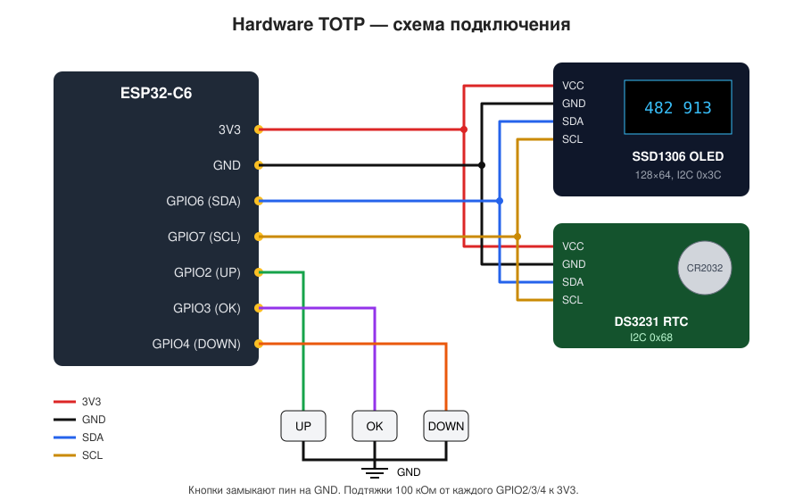

# Hardware TOTP on ESP32-C6

Самодельный аппаратный токен двухфакторной аутентификации (TOTP, RFC 6238) — аналог Google Authenticator в отдельной железке.

- до **16 аккаунтов**, переключение кнопками
- **SHA1 / SHA256 / SHA512**, 6–8 цифр, любой период (обычно 30 с)
- часы реального времени **DS3231** с батарейкой — время не теряется без питания
- OLED **SSD1306 128×64**, имена аккаунтов на кириллице
- **PIN-код** (4 цифры), после **10 неверных попыток всё стирается**
- авто-блокировка и **deep sleep** через 60 с, пробуждение любой кнопкой
- настройка по USB утилитой `token_cli.py`, в т.ч. **импорт экспорта Google Authenticator**
- секреты из устройства **никогда не выдаются обратно** — только добавить/удалить
- Wi-Fi и Bluetooth не используются

```
┌──────────────────────────┐
│2/5 GitHub:artem          │
│──────────────────────────│
│     482    913           │
│ ████████████░░░░░░░░░░░  │
│17s              14:32:05 │
└──────────────────────────┘
```

## Компоненты

| Компонент | Примечание |
|---|---|
| ESP32-C6 (DevKitC-1 или SuperMini) | любая плата с нативным USB |
| OLED SSD1306 0.96" 128×64, I2C | адрес 0x3C |
| DS3231 (модуль ZS-042 или мини-модуль) | адрес 0x68, батарейка CR2032 |
| 3 тактовые кнопки | UP / OK / DOWN |
| 3 резистора 100 кОм | подтяжки кнопок (для надёжного пробуждения) |
| *опционально:* LiPo 300–1000 мА·ч + TP4056 с защитой + выключатель | автономное питание |

## Схема подключения

| ESP32-C6 | Куда |
|---|---|
| 3V3 | VCC OLED, VCC DS3231 |
| GND | GND OLED, GND DS3231, вторые выводы всех кнопок |
| GPIO6 | SDA (OLED и DS3231 параллельно) |
| GPIO7 | SCL (OLED и DS3231 параллельно) |
| GPIO2 | кнопка UP → GND |
| GPIO3 | кнопка OK → GND |
| GPIO4 | кнопка DOWN → GND |



Заметки по железу:

- **Кнопки на GPIO 0–7 — не случайность.** Только LP GPIO могут будить ESP32-C6 из deep sleep. Не переносите кнопки на другие пины. GPIO 8, 9, 15 — strapping-пины, их лучше не трогать.
- Внешние подтяжки 100 кОм к 3V3 обязательны для надёжного пробуждения: внутренние в глубоком сне держатся не на всех ревизиях.
- Подтяжки I2C (4.7–10 кОм) уже стоят на модулях OLED и DS3231, отдельно не нужны.
- **ZS-042 + CR2032:** на модуле есть цепь зарядки для LIR2032. С обычной CR2032 выпаяйте резистор 200 Ом (или диод) рядом с батарейным отсеком.
- Для экономии батареи выпаяйте светодиод питания на модуле DS3231 — он ест ~1–2 мА.
- **Автономное питание:** LiPo → TP4056 (с защитой, OUT+/OUT−) → выключатель → пин 5V платы. Ток во сне ≈ 0.1–0.2 мА (в основном DS3231 и OLED), так что 500 мА·ч хватит на месяцы.

## Быстрый старт

```bash
git clone https://github.com/ArtemDNK/Hardware_TOTP_Esp32.git
cd Hardware_TOTP_Esp32
pio run -t upload            # прошить
pip install -r tools/requirements.txt
python tools/token_cli.py sync
```

## Структура

```
src/main.cpp                    прошивка (Arduino-core 3.x)
platformio.ini                  конфигурация сборки
firmware/firmware.factory.bin   готовый образ для прошивки с адреса 0x0
tools/token_cli.py              утилита настройки по USB
tools/requirements.txt
```

## Прошивка

### PlatformIO (рекомендуется)

```bash
pio run -t upload
```

Используется форк платформы **pioarduino** (Arduino-core 3.x) — у официальной платформы PlatformIO нет нормальной поддержки C6. Библиотеки (U8g2, RTClib) подтянутся сами.

### Arduino IDE

1. Board Manager → установить **esp32 by Espressif** (3.x).
2. Библиотеки: **U8g2**, **RTClib** (Adafruit).
3. Переименовать `src/main.cpp` в `totp_token/totp_token.ino`.
4. Плата **ESP32C6 Dev Module**, **USB CDC On Boot: Enabled**.

### Готовый бинарник

`firmware/firmware.factory.bin` — уже собранный образ, шьётся одной командой с адреса 0:

```bash
esptool --chip esp32c6 write-flash 0x0 firmware/firmware.factory.bin
```

> На DevKitC-1 два USB-разъёма. Прошивка общается через **нативный USB** (разъём «USB»), а не через «UART».

## Первая настройка

```bash
cd tools
pip install -r requirements.txt

python token_cli.py selftest      # проверка алгоритма по RFC 6238
python token_cli.py sync          # время с компьютера (UTC)
python token_cli.py tz 7          # часовой пояс для часов на экране (на коды не влияет)
python token_cli.py setpin        # задать PIN
```

Порт находится автоматически (VID Espressif), иначе укажите `--port COM5` или `--port /dev/ttyACM0`.

### Добавление аккаунтов

На сайте при включении 2FA обычно есть QR-код и ссылка «не могу отсканировать» с текстовым ключом.

```bash
# из otpauth-ссылки (содержимое QR-кода)
python token_cli.py add "otpauth://totp/GitHub:artem?secret=JBSWY3DPEHPK3PXP&issuer=GitHub"

# из экспорта Google Authenticator («Перенести аккаунты» → QR → отсканировать любым сканером)
python token_cli.py add "otpauth-migration://offline?data=CjEKCkhlbGxvId6tvu8..."

# вручную, по текстовому ключу
python token_cli.py add-manual --name "Яндекс" --secret "abcd efgh ijkl mnop"
```

Остальное:

```bash
python token_cli.py list          # список (без секретов)
python token_cli.py move 4 1      # переставить
python token_cli.py del 2         # удалить
python token_cli.py info          # состояние: время, ошибки PIN, RTC
python token_cli.py wipe          # стереть всё
```

Совет: перед тем как удалять 2FA с телефона, проверьте код с токена на сайте.

## Управление

| Экран | UP | DOWN | OK (коротко) | OK (удержание) |
|---|---|---|---|---|
| PIN | цифра +1 | цифра −1 | следующая цифра | на шаг назад |
| Коды | предыдущий аккаунт | следующий | — | заблокировать и уснуть |

Через 60 с без нажатий токен блокируется и засыпает. Если подключён к компьютеру — только гасит экран, чтобы не пропадал COM-порт.

## Консольный протокол

115200 бод, команды строками, ответ заканчивается строкой `OK` или `ERR <причина>`. Пригодится, если захочется сделать свою утилиту или веб-интерфейс.

```
help | info | auth <pin> | logout | list
add <base32> <digits> <period> <SHA1|SHA256|SHA512> <name>
del <n> | move <n> <m> | time [unix_utc] | tz <minutes>
setpin <4 цифры|off> | selftest | wipe YES
```

Если PIN задан, всё кроме `help`, `info`, `auth` требует `auth`. Неудачные `auth` идут в общий счётчик с вводом на кнопках.

## Время и точность

TOTP считается от UTC, поэтому в DS3231 хранится UTC, а часовой пояс влияет только на часы на экране. Точность DS3231 ±2 ppm ≈ ±1 мин в год; серверы обычно принимают коды с отклонением ±30 с. Делайте `sync` раз в 2–3 месяца, `info` покажет текущее расхождение. Если батарейка RTC села — на экране будет «RTC сброшен!» и «Время не задано» вместо кодов.

Без DS3231 токен тоже работает: время держится внутренним RTC ESP32 (в том числе в deep sleep), но теряется при отключении питания.

## Безопасность: что защищено, а что нет

Честно о модели угроз:

- **PIN защищает от «взял токен со стола и посмотрел код».** 10 ошибок → стирание; счётчик пишется во флеш до проверки, поэтому выдёргивание питания его не сбрасывает.
- **PIN не защищает от снятия дампа флеша.** Секреты лежат в NVS в открытом виде; `esptool read-flash` достанет их за минуту. Хеш 4-значного PIN тоже перебирается мгновенно.
- **Как закрыть это по-настоящему:** включить **Flash Encryption** и **NVS Encryption** (eFuse, *необратимо*), отключить download mode и USB-JTAG через eFuse. Удобнее делать в ESP-IDF (menuconfig) — Arduino-ядро этого из коробки не настраивает. Следующий шаг — шифровать секреты ключом из HMAC-периферии C6 (ключ в eFuse, программно не читается).
- Радио выключено → удалённых атак нет, только физический доступ.
- Это не замена резервных кодов: сохраните их при включении 2FA, токен можно потерять или сломать.

## Идеи для доработки

- корпус на 3D-принтере (плата ~ 25×18 мм SuperMini + OLED + CR2032-модуль)
- индикатор заряда батареи через делитель на ADC
- генерация кода HOTP по нажатию
- секреты в зашифрованном NVS + HMAC eFuse
- ввод PIN на 6 цифр, если не устраивает 4
